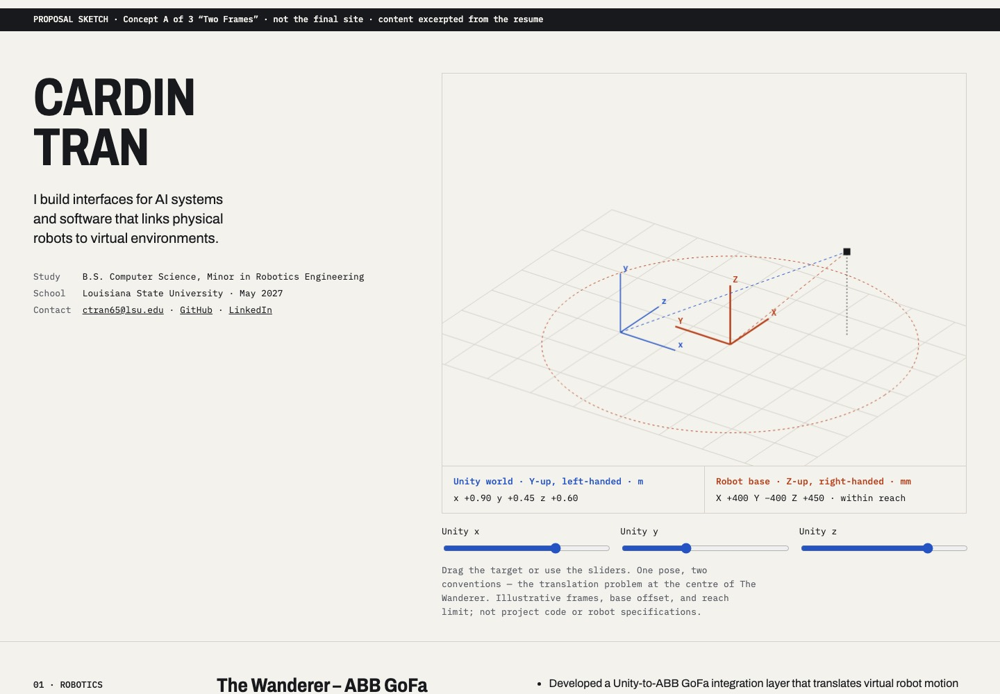
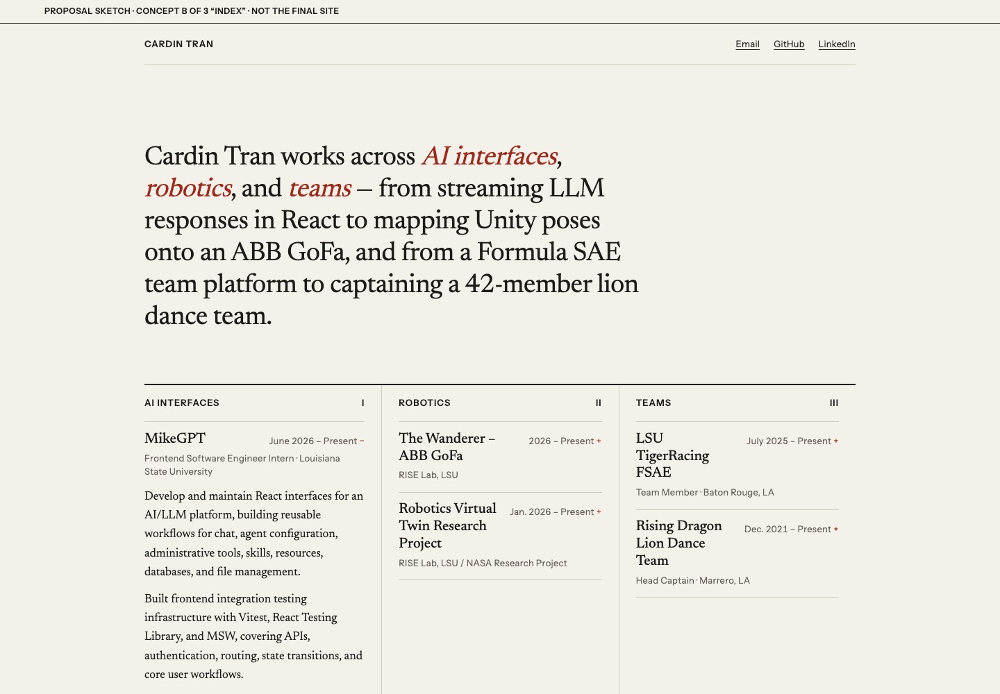
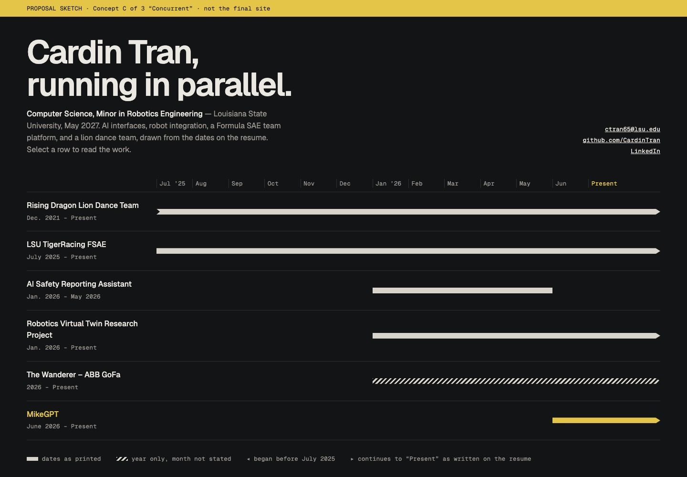

# Design concepts (proposal)

Status: **concept A selected, with chronological structure (D006).** None of these is approved (see D004). The HTML files are throwaway sketches, each labelled as a proposal in the page itself. They show structure, type, and interaction, not finished design. They copy resume text by hand; the real build will render from `src/data/`. Delete this folder once a direction is chosen and recorded in `DECISIONS.md`.

View the sketches by opening the files in a browser, or serve them with `python3 -m http.server -d docs/concepts`. Screenshots are in `screenshots/`.

## What the resume gives a design to work with

- **Translation between systems** recurs throughout: Unity poses become ABB robot poses (The Wanderer), a physical robot gets a virtual twin, and LLM tool execution becomes streamed, readable interface (MikeGPT).
- **Concurrency.** Five of the six entries run to "Present", and four overlap from Jan. 2026.
- **Three domains:** AI interfaces (MikeGPT, Safety Assistant), robotics (The Wanderer, Virtual Twin), and teams (TigerRacing platform, Rising Dragon).
- **No visual assets:** no screenshots, photos, demos, or repository links. Any concept must be strong on type and structure alone, and must not imply project evidence it lacks.

The three concepts each build on a different one of these points, so they differ in structure, not just in palette.

## A · Two Frames: spatial and engineering ([sketch](a-two-frames.html))

**Idea.** The hero is a working diagram: one target point shown simultaneously in a Unity world frame (Y-up, left-handed, metres) and a robot base frame (Z-up, right-handed, millimetres), with a reach check. This is the problem The Wanderer's bullets describe, so the interactive element explains the work instead of decorating it. The rest of the page is a numbered spec sheet: sticky section labels, condensed headings, and monospace metadata.

- **Hierarchy:** name, a one-line statement, the diagram, then Robotics → AI interfaces → Teams → Tools. This leads with the robotics work, the most distinctive material on the resume.
- **3D cost:** under 200 lines of Canvas 2D, with no three.js and no continuous render loop (it redraws only on input). Native range sliders make it keyboard- and screen-reader-operable. It has no idle motion, so reduced motion needs no changes.
- **Mobile:** the diagram drops below the statement at full width, the readouts stack, and the sliders stay usable by touch.
- **Risks:** the diagram must stay clearly illustrative. It is labelled "not project code or robot specifications", and the frames, base offset, and reach limit are invented for the illustration. It weights the page toward robotics, so AI work sits second.

## B · Index: editorial and typography-led ([sketch](b-index.html))

**Idea.** A printed-monograph feel. A serif statement names the three domains with one concrete detail each. Below it, a three-column index (AI interfaces / Robotics / Teams) where every entry opens in place with native `
`. Education, coursework, and tools form a colophon in running text rather than badges.

- **Hierarchy:** gives every domain equal weight. Visitors scan titles and dates first and open only what they care about, so the whole resume fits on one calm screen.
- **3D cost:** none. Almost zero JavaScript: the disclosure behaviour is native, and the only motion is a 160 ms settle that is removed under reduced motion.
- **Mobile:** the columns collapse to one index, so it reads like a well-set table of contents.
- **Risks:** it is the quietest option, and its distinctiveness rests entirely on type and copy. With no imagery available, it may feel understated. The 3D interest you mentioned would have to be added later, in a project detail.

## C · Concurrent: timeline-led ([sketch](c-concurrent.html))

**Idea.** The hero is a chart of every entry against time, built only from the printed dates. Selecting a row reveals that entry's bullets. The overlap of research, an internship, a team platform, and a lion dance team is shown, not claimed. Wording is preserved honestly: The Wanderer's year-only date is hatched, a notch marks Rising Dragon as starting before the chart, and "Present" is its own column, not a calendar date.

- **Hierarchy:** time first, then the domains (implicitly), then details. The most current work is selected by default.
- **3D cost:** none. Small JavaScript for selection, and no animation.
- **Mobile:** each row stacks its label above its bar. Every second month label on the axis is hidden, while bar placement keeps the timing readable.
- **Risks:** a chart treats every entry as the same kind of thing. A one-semester project and a four-year captaincy look comparable apart from bar length. The sketch's `display: contents` buttons would be rebuilt with subgrid for reliable accessibility. The dark palette is just one option.

## Combinations worth considering

These parts are separable. B's index could replace A's spec-sheet sections below A's diagram hero. C's timeline could become a compact band under B's statement. Choosing one direction and borrowing a single element from another is a reasonable outcome.

## Questions for the owner

1. **Direction:** A, B, C, or a combination?
2. **Lead area:** should robotics, AI interfaces, or neither lead the page?
3. **May 2027:** may it be labelled "expected", or should it stay unlabelled as printed?
4. **Contact:** confirm that email, LinkedIn, and GitHub are the contacts to publish, and that the phone number and home address stay off the site (D005).
5. **Assets:** are any project visuals available (screenshots, photos, video, public repositories)? All three concepts are designed to work without them, and would improve with authentic ones.
